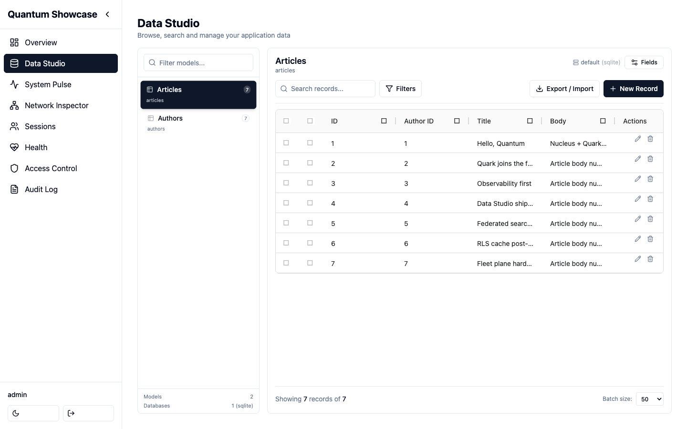

# Orbit

**The pluggable admin product for the [Nucleus](/nucleus/) framework.**

Orbit is a self-contained admin panel — Data Studio, a live request and SQL
feed, a session viewer, RBAC management and system metrics — that mounts
**in-process** into any Nucleus application through the framework's
extension/module API.

*Data Studio browsing a host application's models, light theme. The panel
also ships a dark theme.*

You add one dependency and one `Mount(...)` call, and hand the panel the data
source built from your application's models — a 2.0 application defines its
models with the [Quark](https://github.com/jcsvwinston/quark) ORM and passes
a `quarkdatasource` adapter as `orbit.Config.DataSource`. Orbit then reads
everything else it needs from the running application's `Runtime` and serves
its **embedded** React interface. There is no separate asset deployment, no out-of-process
sidecar and no database of its own.

Orbit is a separate Go module with its own release cadence. The admin panel was
moved out of the framework core so the core stays lean and the panel can evolve
as its own product.

## What you get

| Module | What it does |
|--------|--------------|
| **Data Studio** | Browse, create, edit, and delete records for every Quark model the application registers on its data source — tenant-aware, with import/export. |
| **Live runtime inspector** | Real-time feed of incoming HTTP requests and executed SQL across the whole app, with optional cross-node aggregation. |
| **Session viewer** | List active server-side sessions — whose, from what device, which one is you — and revoke one or every session of an account. |
| **Access control (RBAC)** | Inspect and manage the Casbin policies and roles backing the app's authorizer. |
| **System metrics** | Runtime and resource consumption — CPU, memory, goroutines, database pool. |
| **Audit log** | A durable trail of admin actions, with retention, export and per-record history. |
| **Overview & Health** | Dashboard and health at a glance. |

The interface ships **embedded in the binary** (`go:embed`) and version-pinned
to the Orbit module. Mount Orbit and you get the whole admin panel offline, in
a single binary.

## How much of Orbit do you need?

Most applications need only the first row. The other two are additive, and you
can adopt them later without changing how the panel is mounted.

| Shape | What it adds | What you run |
|---|---|---|
| **The in-process panel** | The admin panel, showing live state for **its own node**. | Nothing extra — it is inside your application binary. |
| **The live-feed relay** | One shared live feed across the nodes of a single application. | A Redis instance. Enabled with the `cluster_*` keys in [Configuration](./configuration.md). |
| **The fleet plane** | A dedicated, always-on observability server that outlives any one application node. | A standalone `admin-server` binary, plus an agent embedded in each node. See [Fleet observability](./cluster/overview.md). |

:::note Two different things are called "cluster"
The `cluster_*` **configuration keys** switch on the Redis live-feed relay —
still the in-process panel, just sharing one feed between nodes. The
**Fleet observability** section documents something else entirely: the
standalone agent-and-server plane, which does not use Redis. Neither one
requires the other.
:::

## Requirements

- **Go 1.26+**
- A **[Nucleus](/nucleus/)** application to mount into.
- The application's models defined with the
  **[Quark](https://github.com/jcsvwinston/quark)** ORM, registered on a
  `quarkdatasource` adapter the panel takes as `orbit.Config.DataSource`.
  The panel does not start without a data source; there is no default
  (the Nucleus adapter over the framework's model registry left at 2.0).
- *(Optional)* **Redis** — only for the live-feed relay described above
  (`cluster_*` in [Configuration](./configuration.md)).

## Status

The current tagged release is **v1.20.1**. <!-- x-release-please-version --> The
public API — the root module and `datasource` — is stable for the life of a
major: it does not change in a breaking way within one. What the 2.0 major
changed, and how to move an application onto it, is in
[Upgrading](./operations/upgrade.md#upgrading-to-20).

Next: [Quick start](./quick-start.md).
