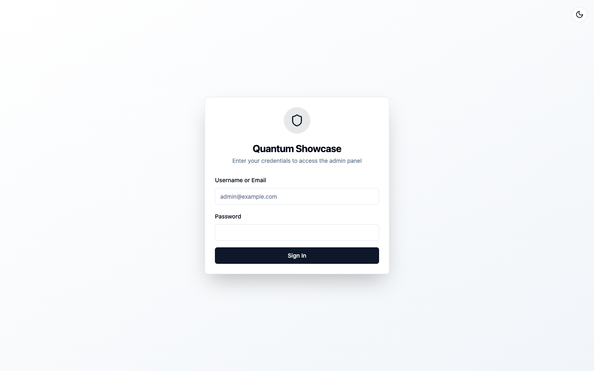

# Quick start

One dependency and one `Mount(...)` call give your Nucleus application a full
admin panel at `/admin` — Data Studio, a live request and SQL feed, sessions,
RBAC and metrics. It is served straight from your own binary: nothing separate
to deploy, no sidecar process, no database of its own.

You need Go 1.26 or newer, a Nucleus application to mount into, and its
models defined with the [Quark](https://github.com/jcsvwinston/quark) ORM:
a 2.0 application defines its models with Quark, and Data Studio browses
them through the `quarkdatasource` adapter you hand the panel
([step 4](#4-register-a-model-so-data-studio-has-something-to-show)). The
panel does not start without one.

## 1. Add the dependency

```bash
go get github.com/jcsvwinston/orbit@latest
```

The current release is v1.20.1; pin that tag rather than `@latest` for reproducible builds. <!-- x-release-please-version -->

## 2. Mount the module

```go
import (
    "os"

    "github.com/jcsvwinston/nucleus/pkg/nucleus"
    "github.com/jcsvwinston/orbit"
)

func main() {
    app, err := nucleus.New().
        FromConfigFile("nucleus.yml").
        Mount(orbit.Module(orbit.Config{
            Prefix:            "/admin",
            Title:             "Acme Admin",
            // The data source Data Studio browses: the quarkdatasource
            // adapter step 4 builds from your Quark models. The panel does
            // not start without one.
            DataSource:        notes(),
            BootstrapUsername: "admin",
            BootstrapEmail:    "admin@acme.test",
            // When BootstrapPassword is empty, no admin user is created —
            // provision it another way (e.g. nucleus createuser). The admin
            // users schema is created at mount either way.
            BootstrapPassword: os.Getenv("ADMIN_BOOTSTRAP_PASSWORD"),
        })).
        Build()
    if err != nil {
        panic(err)
    }
    if err := nucleus.Run(app); err != nil {
        panic(err)
    }
}
```

## 3. Start the app and sign in

Run the application, open `/admin`, and sign in as the bootstrap user.



You do not wire up any protection yourself. Orbit registers its prefix with the
framework's default-deny RBAC and enforces its own session-based login below
that prefix, so the panel is gated from the first request.

## 4. Register a model so Data Studio has something to show

Orbit brings no data of its own: Data Studio browses the **data source
your application hands it** (`orbit.Config.DataSource`, which the panel
requires: it does not start without one). If that source holds no models
— as an empty adapter does — the panel mounts and logs you in, but Data
Studio lists zero models. That is expected, not a broken install.

A model appears in Data Studio the moment you register it on the source.
With the [Quark](https://github.com/jcsvwinston/quark) ORM that means a
`quarkdatasource` adapter over your client, one `Register` per model, and
a table for it:

```go
import (
    "context"
    "log"

    "github.com/jcsvwinston/quark"
    _ "github.com/jcsvwinston/quark/drivers/sqlite"

    "github.com/jcsvwinston/orbit"
    "github.com/jcsvwinston/orbit/quarkdatasource"
)

type Note struct {
    ID    int64  `db:"id" pk:"true"`
    Title string `db:"title" quark:"not_null"`
    Body  string `db:"body"`
}

func notes() *quarkdatasource.Adapter {
    client, err := quark.New("sqlite", "app.db")
    if err != nil {
        log.Fatal(err)
    }
    // Dev-mode convenience; production apps use SQL migrations.
    if err := client.RegisterModel(&Note{}); err != nil {
        log.Fatal(err)
    }
    if err := client.MigrateRegistered(context.Background()); err != nil {
        log.Fatal(err)
    }
    src := quarkdatasource.New(client)
    if err := quarkdatasource.Register[Note](src); err != nil { // ← this line puts Note in Data Studio
        log.Fatal(err)
    }
    return src
}
```

Hand the adapter to the panel where you mount it — the `DataSource: notes()`
line of step 2:

```go
orbit.Module(orbit.Config{Prefix: "/admin", DataSource: notes()})
```

Restart, open Data Studio, and `Note` is there — browse, create, edit,
delete. Every model you `Register` on the adapter shows up the same way;
Orbit needs no per-model configuration. The adapter lists every column of a
model, searches every string column and filters every scalar one; the
primary key is read-only. Several databases are several adapters, one per
Quark client, each serving its own alias (`quarkdatasource.WithDatabaseAlias`).

Model definition is a Quark concept, not an Orbit one — see the
[Quark](https://github.com/jcsvwinston/quark) documentation for tags,
relations and real migrations. The panel's own tables (operators, sessions,
the audit trail) are not models of the source and need nothing from it.

## The bootstrap user

Orbit creates the `nucleus_admin_users` schema every time it mounts.
`BootstrapPassword` only decides whether an admin **user** is created in it:

- **Set** — on first start Orbit creates the user named by
  `BootstrapUsername`, unless that user already exists.
- **Empty** — no admin user is created. Provision one another way, for
  example with the framework's `nucleus createuser` command against the same
  database, before you try to sign in. Because the schema already exists
  after the first start, `createuser` works right away — no bootstrap
  password is ever required.

Once the first operator is in, the rest are created from the panel itself —
see [Operators](./features.md#operators). The bootstrap user is how the first
one gets there, not how every one does.

Reading the password from the environment, as the snippet above does, keeps it
out of your source tree.

## Every option but one has a default

`orbit.Config`'s zero value is valid except for `DataSource`, which the panel
requires (step 4). This mounts the panel under `/admin` with default settings
and no bootstrap user:

```go
.Mount(orbit.Module(orbit.Config{DataSource: notes()}))
```

Next: [Configuration](./configuration.md) for every option, or
[How it works](./how-it-works.md) for the runtime model.
